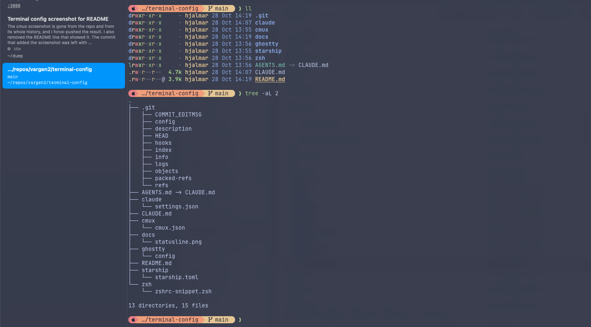

# terminal-config

My macOS terminal setup: **cmux** (or plain **Ghostty**) + **Starship** prompt, Catppuccin colours, JetBrainsMono Nerd Font.



> Setting this up with an AI agent? Point it at [`CLAUDE.md`](CLAUDE.md). It has step-by-step instructions.

## What's in here

| File | Install to | Used by |
|---|---|---|
| `ghostty/config` | `~/.config/ghostty/config` | Ghostty **and** cmux (cmux embeds libghostty and reads this file) |
| `starship/starship.toml` | `~/.config/starship.toml` | Starship prompt |
| `cmux/cmux.json` | `~/.config/cmux/cmux.json` | cmux |
| `zsh/zshrc-snippet.zsh` | append to `~/.zshrc` | zsh |
| `claude/settings.json` | **merge** into `~/.claude/settings.json` | Claude Code |

## Required vs optional

### Required (the prompt looks broken without these)
- **JetBrainsMono Nerd Font**: `brew install --cask font-jetbrains-mono-nerd-font`. Starship's powerline arrows and icons are Nerd Font glyphs, so without the font they show as boxes.
- **Starship**: `brew install starship`, plus `eval "$(starship init zsh)"` in `~/.zshrc`.
- **A terminal that uses the font**: Ghostty/cmux with `font-family = JetBrainsMono Nerd Font` (set in `ghostty/config`). If you use another terminal, set its font to the Nerd Font.

### Optional

**Terminal app**
- **cmux** (`brew install --cask manaflow-ai/cmux/cmux`, or download from cmux.dev): Ghostty-based terminal with workspaces/sidebar, built for running coding agents.
- **Ghostty** (`brew install --cask ghostty`): plain terminal. Either one works; both read `ghostty/config`.

**`ghostty/config`**
- `theme`, `background-opacity`, `background-blur`: the look. Safe to keep.
- `window-width/height`, `macos-icon`, `quit-after-last-window-closed`, `copy-on-select`: personal taste.

**`starship/starship.toml`**
- Segments shown: OS icon → directory → git branch/status → command duration.
- Uses the `catppuccin_frappe` palette to match Ghostty's `Catppuccin Frappe` theme. If you change one, change the other (`mocha`/`macchiato`/`latte` palettes are also defined in the file).
- No language/version segments. To add one (e.g. `$nodejs`), put it in the top-level `format` string; modules not listed there never render.
- `cmd_duration` sends a desktop notification for commands over 45s.

**`cmux/cmux.json`**
- Rebinds sidebar tab next/prev to `cmd+ctrl+↓/↑` and sets `customSidebars.renderer` to `inProcess`. Everything else is cmux default. The full list of options is in the `$schema` URL, or open cmux Settings.

**`zsh/zshrc-snippet.zsh`**
- Autosuggestions, syntax highlighting, history substring search (brew packages), `ll` via `eza`, and `c` for `clear`.

**`claude/settings.json`** (Claude Code; all optional, a trimmed-down version of my own settings)
- `statusLine`: one line with dir, git branch, model, effort, and a context-usage bar. Needs `jq` (`brew install jq`).

  
- `subagentStatusLine`: shows each running subagent's label, model, and effort. Needs `jq`.
- `theme: dark-ansi`: Claude Code uses the terminal's ANSI colours, so it picks up the Catppuccin theme.
- `outputStyle: Concise` and `spinnerVerbs` set to just "Thinking": shorter answers and a calmer spinner.
- `attribution` left empty: no "Co-Authored-By Claude" in commits and PRs. Remove this if your team wants that line.
- `permissions.deny`: blocks `sudo`, `rm -rf ~`, disk tools, and shutdown/reboot. `permissions.ask`: always confirm `git push`.

Left out on purpose: the allow-everything permissions and auto mode, my model, effort, and env tuning, my hooks, skills, and plugins, and `enableAllProjectMcpServers`, which trusts any MCP server a repo declares.

## Updating this repo from my machine

```sh
cp ~/.config/starship.toml starship/starship.toml   # the repo copy drops unused module blocks; re-trim after copying
cp ~/.config/cmux/cmux.json cmux/cmux.json
# claude: claude/settings.json is a hand-trimmed subset of ~/.claude/settings.json. Copy over changed keys by hand
# ghostty: my live file is ~/Library/Application Support/com.mitchellh.ghostty/config. Merge changes by hand (the repo copy is cleaned up and annotated)
```
